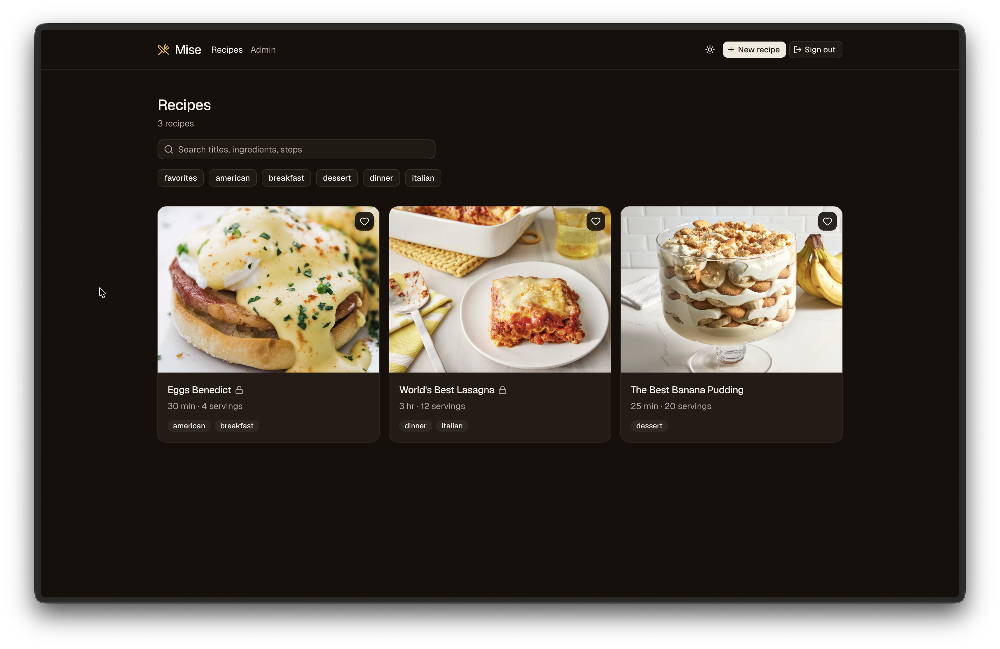

# mise

a self-hosted recipe manager, inspired by mealie.



## dev

you need [bun](https://bun.sh).

```bash
bun install
bun dev
```

open [localhost:5173](http://localhost:5173). the api listens on port 3001, and vite proxies `/api` and `/uploads` to it.

the first visit asks you to create an admin account; after that, sign-up is closed and only admins can add new users. there are also three demo recipes to get you started.

## docker

on the machine that will run it:

```bash
mkdir mise
cd mise
curl -fsSL -o compose.yml https://raw.githubusercontent.com/durocodes/mise/main/compose.yml
docker compose up -d
```

open [localhost:3000](http://localhost:3000) to get started. the first visit creates the admin account.

### notes

set `BETTER_AUTH_URL` to the public origin, such as `https://mise.example.com`, when the site is not served from localhost.

`DATA_DIR` is where sqlite and uploads are stored. change the left side of `3000:3000` to use a different host port. you can customize these in the `compose.yml` file.
